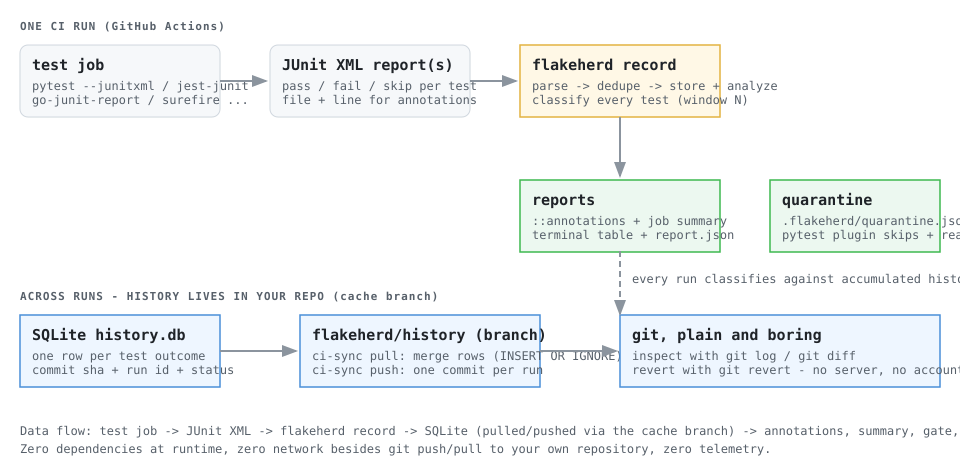

# FlakeHerd

**History-aware flaky-test detection and quarantine for GitHub Actions.**

FlakeHerd watches your test results *across CI runs*, builds a per-test history inside your own repository, and tells you which failing tests are **proven flaky**, which are **real regressions**, and which are **still broken** - then it can quarantine the flakes so your team stops re-rolling CI dice.

- Works with **any framework that emits JUnit XML** (pytest, jest, Go, Java/Kotlin, vitest, Playwright, cargo-nextest, ...)
- History is a **SQLite database on a cache branch inside your repo** - no server, no account, no telemetry
- **Zero runtime dependencies** (pure Python standard library, Python >= 3.9)
- Ships as a CLI and a **GitHub Actions composite action**

```
CLASS              TEST                                       N   FAIL%  SCORE  RECENT
--------------------------------------------------------------------------
broken             upload.UploadTest::test_multipart_resume  8  100.0%     20  FFFFFFFF
regression         api.RateLimitTest::test_rate_limit_headers 8   50.0%     11  PPPPFFFF
confirmed flaky    payment.RetryTest::test_retry_on_timeout   8   12.5%     75  PPFPPPPP
flaky (low conf.)  flags.FlagTest::test_experiment_ratios     8   25.0%     43  PPFFPPPP
fixed              cache.EvictionTest::test_eviction_order    8   50.0%     26  FFFFPPPP
```

*(Real output from `demo/run_demo.sh` - every column explained below.)*

---

## Why

Flaky tests are a widespread, measurable tax:

- 59% of developers hit flaky tests at least monthly (Parry et al., ACM TOSEM survey)
- 26% of teams report flakiness affecting their CI (Bitrise Mobile Insights 2025, up from 10% in 2022)
- 51.3% of Java OSS projects show flaky re-runs (arXiv 2602.02307, 1,960 projects)
- **GitHub Actions has no built-in flaky-test detection** - and the only open-source GitHub Action dedicated to it died in 2022 (see `docs/RESEARCH.md`)

The usual responses are worse than the disease: rerun the job until it goes green (hides real failures), delete the flaky test (loses coverage silently), or buy a SaaS (your test data leaves your repo). FlakeHerd's bet is that the evidence to classify flakiness **already exists in your CI history** - you just need to record it, keep it in-repo, and reason about it honestly.

## The taxonomy (what the columns mean)

Every test gets classified from its last N outcomes (default 30):

| Class | Meaning |
| --- | --- |
| `confirmed flaky` | The **same commit** both passed and failed across runs (e.g. a re-run went green). Strongest possible evidence - score base 70. |
| `flaky` | Oscillating history: 3+ pass/fail transitions across runs. Score base 60. |
| `suspected flaky` | Failed then recovered **inside a single run** (an auto-retry or rerun that went green). Direct evidence of nondeterminism, but a single mechanism: suspicion, not proof - score base 45, quarantined only behind the low-confidence opt-in, and it never excuses a current failure from the gate. |
| `flaky (low conf.)` | Exactly 2 transitions: a one-off flake (P F P) or a break-then-fix (P F F P). Reported, quarantined only on request. |
| `regression` | Used to pass, now failing for `min_regression_streak` (default 2) consecutive runs with little historical flip-flop. **A bug, not a flake.** |
| `broken` | Failed every recorded run - including tests that failed *every* retry attempt (retries that never recover are not flakiness). **A bug, not a flake.** |
| `fixed` | Failed earlier, passing again. |
| `watch` | First failure after a passing streak - could be the first flake or a new regression. Needs evidence. |
| `new` | First recorded run - no verdict yet. |
| `stable-pass` / `skip-only` | Boring, healthy. |

`N` is the number of recorded samples, `FAIL%` the failure rate over pass/fail samples, `SCORE` a 0-100 blend of class, failure rate and transition density (used for ranking and quarantine thresholds), and `RECENT` the last 10 outcomes (`P` pass, `F` fail, `.` skip).

**The gate.** With `--fail-on unexplained` (the action's default), a currently-failing test fails the CI job *unless* it has **proven** flaky evidence in its history (`confirmed flaky`, `flaky`, `flaky (low conf.)`). Tests are innocent until proven flaky: a brand-new failure still breaks your build, a *suspected* flake (one recovered retry) does not buy a free pass, and a test that fails every retry attempt stays red - retries can never silently turn a genuine failure into a green gate.

## Quickstart (CLI)

```bash
pip install -e .            # or from a checkout; no dependencies are pulled

# after any test run that produced JUnit XML:
flakeherd record --junit 'junit.xml' --sha $(git rev-parse HEAD) --run-uid run-1
flakeherd record --junit 'junit.xml' --sha $(git rev-parse HEAD) --run-uid run-2
# ...after a few runs:
flakeherd report                          # the table above
flakeherd quarantine                      # writes .flakeherd/quarantine.json
flakeherd ci-sync --mode push              # persist history to the cache branch

# a health score + local SVG badge from the JSON report:
flakeherd record --junit 'junit.xml' --json-out report.json --no-report
flakeherd health --report report.json --badge test-health.svg
```

## Quickstart (GitHub Actions)

```yaml
jobs:
  test:
    runs-on: ubuntu-latest
    permissions:
      contents: write        # only needed for the history branch
    steps:
      - uses: actions/checkout@v4
        with:
          persist-credentials: false
      - run: python -m pytest --junitxml=junit.xml -q || true   # your tests
      - uses: <owner>/flakeherd@main                            # the action
        with:
          github-token: ${{ secrets.GITHUB_TOKEN }}
          junit-glob: 'junit.xml'
          fail-on: 'unexplained'
          quarantine: 'true'
```

**Security note:** `persist-credentials: false` is important: it prevents the checkout token from being left in Git configuration where test code could read it. FlakeHerd receives `github-token` only on its history pull/push steps, not on the test-running step. Keep `contents: write` only on trusted workflows; for untrusted fork pull requests, use a read-only workflow and do not grant write permissions.

The action pulls shared history, records results, writes GitHub **annotations** and a **job summary**, then pushes history to `flakeherd/history` when the token has write permission.

A full runnable workflow lives in [`examples/workflows/flakeherd-basic.yml`](examples/workflows/flakeherd-basic.yml).

## How it works



1. **Record.** Each CI job parses its JUnit XML files (`.xml` and `.xml.gz`) and stores one outcome row per test - keyed by `classname::name`, stamped with commit sha and run id - in a local SQLite database.
2. **Sync.** `ci-sync pull` merges the branch's database into the local one (idempotent `INSERT OR IGNORE`), `ci-sync push` commits the merged database back. Two racing CI jobs cannot silently lose each other's rows: the pushed database is always a superset of the branch tip, and a lost push race is retried once.
3. **Analyze.** Every test is classified against its history window (see the taxonomy). Duplicates within one run (shards, retries) are merged: a test that both passed and failed inside one run is recorded as a pass with in-run flakiness evidence.
4. **Report.** Terminal table, `::warning`/`::error` annotations (with `file`/`line`), a Markdown step summary, and a machine-readable `report.json` (including per-test retry evidence from the current run).
5. **Quarantine.** `flakeherd quarantine` writes a JSON manifest of *proven* flakes (optionally under the score-threshold policy with expiry + audit reasons). The bundled pytest plugin (auto-registered on install) skips matching tests **with the recorded reason**, so the cost of flakiness stays visible instead of silently deleting tests. `$FLAKEHERD_MANIFEST` points other setups at the manifest.

## Supported inputs

| Producer | How |
| --- | --- |
| pytest | `--junitxml=junit.xml` (recommended), optionally with FlakeHerd's own `--flakeherd-retries`; pytest-rerunfailures output is read too (see note below) |
| jest / vitest | `jest-junit` reporter / `--reporter=junit` |
| Go | `go test -v \| go-junit-report` |
| Maven / Gradle | Surefire / JUnit XML reports |
| Anything else | any JUnit XML: `<testsuites>` or `<testsuite>` root, `classname`/`file`/`line` attributes honored, `status` attribute fallbacks for TestNG-style reports |

**Retry-plugin notes.** FlakeHerd's own `--flakeherd-retries` writes explicit
per-attempt evidence (properties + per-attempt `<testcase>` elements), which
the parser reads back losslessly. pytest-rerunfailures is *parsed* too:
`<rerunFailure>` elements count as failed attempts, and since rerunfailures
>= 15 emits failed attempts as bare elements, FlakeHerd takes the last
element's status for duplicated testcases (the final attempt decides) while
keeping the divergence as flakiness evidence - so a test that failed every
rerun is recorded as failing, not green. Maven Surefire `<flakyFailure>`
(recovered flakes) is read as pass + evidence.

## See it work

```bash
pip install -e . -r requirements-dev.txt
bash demo/run_demo.sh
```

The demo runs three parts and prints real output:

1. **Deterministic simulation** - eight recorded runs that light up every classification;
2. **A real pytest suite with a genuinely flaky test** - recorded across eight real test executions, detected, quarantined, and visibly skipped;
3. **Cache-branch sync** - two checkouts sharing one bare origin (exactly like two CI runners), accumulating history across pushes.

A recorded transcript is checked in at [`docs/DEMO_OUTPUT.txt`](docs/DEMO_OUTPUT.txt).

## Configuration

Everything has a default; `.flakeherd.json` is optional (see `.flakeherd.example.json`):

| Key | Default | Meaning |
| --- | --- | --- |
| `window` | 30 | outcomes per test considered |
| `max_runs` | 500 | runs kept in the database (pruned automatically) |
| `min_regression_streak` | 2 | consecutive trailing failures that make a regression |
| `max_annotations` | 10 | annotation cap per severity (GitHub caps: 10 errors, 10 warnings, 5 notices) |
| `quarantine_min_score` | 0 | minimum score to quarantine (legacy, policy-independent) |
| `include_low_confidence` | false | also quarantine `suspected flaky` and `flaky (low conf.)` |
| `quarantine_threshold_enabled` | false | **opt-in**: enable the score-threshold quarantine policy |
| `quarantine_score_threshold` | 40 | policy floor for the quarantine score (only with the policy on) |
| `quarantine_min_samples` | 5 | minimum recorded samples before automated quarantine (policy on) |
| `quarantine_expiry_days` | 0 | stamp new entries with an expiry date; 0 = never expire |
| `ignore` | `[]` | fnmatch patterns excluded from analysis |

CLI flags override the file; `FLAKEHERD_DB` overrides the database path.

## Auto-retry with preserved evidence (pytest)

FlakeHerd ships a first-party auto-retry adapter for pytest. It is **opt-in**
and off by default - installing flakeherd never changes how your tests run.

```bash
pytest --flakeherd-retries 2 --junitxml=junit.xml   # up to 2 extra attempts
flakeherd record --junit junit.xml                   # evidence flows into history
```

You can also set it in `pytest.ini` / `pyproject.toml`:

```ini
[pytest]
flakeherd_retries = 2
```

What it guarantees:

* **Configuration**: `--flakeherd-retries N` (or the `flakeherd_retries` ini
  setting) bounds attempts at N extra tries; negative values are rejected.
* **Evidence is preserved, never discarded**: every attempt is reported as
  its own JUnit `<testcase>` - earlier attempts keep their **original failure
  tracebacks** - and the final attempt additionally carries
  `<properties>` with `flakeherd_retry_attempts`,
  `flakeherd_retry_outcomes` (e.g. `"F,P"`) and a capped excerpt of the
  first failure. `flakeherd record --json-out` surfaces the same data in
  each test's `current_run` object.
* **Fail-then-pass is *suspected*, not confirmed**: the test is classified
  `suspected flaky` (score base 45) - real evidence of nondeterminism, but
  it never becomes `confirmed flaky` on one recovery, is quarantined only
  behind the explicit low-confidence opt-in, and does not excuse future
  failures from the gate.
* **A genuine failure stays red**: the *final* attempt decides the recorded
  outcome. A test that fails all attempts is recorded as `fail` (and
  eventually `broken`) - it gates your build exactly as if no retry had
  happened. Interruptions (Ctrl-C / `KeyboardInterrupt`) abort the session;
  the retry loop never swallows them, and evidence from attempts that
  already ran is kept.
* Skipped tests (including quarantined ones) are never retried; teardown
  failures are not retried (the test body itself passed).

Compat: FlakeHerd's JUnit parser also reads pytest-rerunfailures output and
Maven Surefire `<flakyFailure>` records (see *Supported inputs*). Do not run
`--flakeherd-retries` and `--reruns` together - both drive the same pytest
hook. Other framework adapters can emit the same
`flakeherd_retry_*` property contract into their JUnit XML; pytest is simply
the first supported integration, not the only conceivable one.

## Quarantine policy: score threshold, minimum samples, expiry

The quarantine manifest (`.flakeherd/quarantine.json`) predates 0.2.0; the
policy layer on top of it is **entirely opt-in**. Enable it in
`.flakeherd.json`:

```json
{
  "quarantine_threshold_enabled": true,
  "quarantine_score_threshold": 40,
  "quarantine_min_samples": 5,
  "quarantine_expiry_days": 30
}
```

* **Threshold (default 40, only when the policy is enabled)**: a test needs
  a flakiness score of at least 40 to qualify. `--min-score` and
  `quarantine_min_score` can only *raise* the effective threshold - the
  policy is a safety floor, not a ceiling.
* **Sufficient evidence required**: fewer than `quarantine_min_samples`
  (default 5) recorded outcomes disqualify any automated quarantine.
* **Only eligible classes qualify, always**: `confirmed-flaky` and `flaky`
  by default; `suspected-flaky` and `flaky-low` only with
  `include_low_confidence`. A `broken` or `regression` test is **never**
  quarantined, whatever the configuration says - quarantine must never hide
  a bug.
* **Expiry + audit**: new entries carry `expires_at` (when
  `quarantine_expiry_days` > 0) and a machine-generated `audit_reason`
  (`score 62 >= 40; class flaky; samples 8 >= 5; policy=threshold`). Expired
  entries stop being skipped - the test runs again and the quarantine must
  be re-earned with fresh evidence. Manifests stay schema-compatible with
  0.1.x in both directions (new fields are optional).
* **Suggestion mode by default**: with the policy enabled, `flakeherd
  record` only *suggests* candidates (and includes them as
  `quarantine_suggestions` in the JSON report). Writing the manifest
  requires the explicit `flakeherd quarantine` command or `record
  --auto-quarantine`. Either way the manifest is a file in your working
  tree - FlakeHerd never commits or pushes it.
* Quarantined tests remain **visible**: the pytest plugin skips them with
  the recorded reason (e.g. `flakeherd quarantine [flaky]: 4 pass/fail
  transitions...`), and `FLAKEHERD_DISABLE=1` turns quarantine off entirely.

## Test Health metric and README badge

`flakeherd health` turns a `record --json-out` report into one honest
number plus a small SVG badge - rendered locally, with no external badge
service and no invented public URL.

```bash
flakeherd record --junit junit.xml --json-out report.json --no-report
flakeherd health --report report.json --badge test-health.svg --json-out health.json
```

Then, if you commit the badge:

```markdown

```

**The formula (metric version 1) is transparent and fixed** - a weighted
average over classification counts:

| Class | Weight |
| --- | --- |
| `stable-pass`, `fixed` | 100 |
| `watch` | 50 |
| `suspected flaky`, `flaky (low conf.)` | 25 |
| `confirmed flaky`, `flaky`, `regression`, `broken` | 0 |

`new` and `skip-only` tests carry no verdict and are excluded from both the
numerator and the denominator. The output exposes the score, the sample
size (runs, total tests, scored tests), an explicit `insufficient-data`
state when fewer than `--min-runs` (default 5) runs exist, the generation
timestamp and the metric version - so trend lines can detect formula
changes.

**This is a heuristic indicator, not a statistically valid probability or a
literal reliability percentage.** The badge says `87/100`, never "87%
reliable". With too little history it renders a gray **no data** badge
instead of inventing a number.

The badge is never pushed anywhere automatically. For CI recipes
(artifact upload, or a secure optional push to a dedicated branch with a
scoped token) see [`docs/BADGE_WORKFLOW.md`](docs/BADGE_WORKFLOW.md) and
[`examples/workflows/flakeherd-health.yml`](examples/workflows/flakeherd-health.yml).


## How this differs from what exists

Full audit in [`docs/RESEARCH.md`](docs/RESEARCH.md). Short version:

| Approach | Examples | FlakeHerd's difference |
| --- | --- | --- |
| Rerun-based CLI (Go) | `smartcontractkit/flakeguard`, `ncbi/deflake` | no re-rolls of CI dice: classifies from history you already produce, JVM/JS/Go/Python via one XML format |
| SaaS analytics | BuildPulse, Trunk, Datadog CI Visibility, Flakehouse | zero servers, zero accounts - history never leaves your repository |
| Single-ecosystem OSS | `flake-guard-alpha` (jest), `Flake-doctor` (pytest) | framework-agnostic input + an explicit taxonomy that separates flakes from regressions |
| Dead OSS action | WithSecure flaky-tests-detection (2022) | active development: 287 automated tests; lint and demo jobs are configured in CI |

## Status and honest limitations

**Tested here:** unit + integration suite (287 tests) including real git push/pull against local bare repositories, real pytest collection runs, real auto-retry runs whose generated JUnit XML is parsed back and classified, threshold-boundary and expiry tests for the quarantine policy, health-metric and SVG-badge tests, and structural validation of the composite action and CI workflows (no input interpolation into shell source, token scoped to sync steps, least-privilege permissions); the demo above (now including a retry + badge part).

**Not yet validated:** runs on real GitHub-hosted runners (`action.yml` is written and YAML-validated, and the dogfood workflow exists, but the maintainer has not yet executed it on GitHub infrastructure); PyPI publication; Python 3.9-3.11 on real interpreters (CI matrix is configured but unexecuted). See `ROADMAP.md` for the full, honest list.

**Known design trade-offs:** concurrent CI jobs share history through last-writer-wins on a cache branch (with merge-before-push and one retry, so data loss requires losing the same race twice); divergent pass/fail duplicates inside one run are recorded with the *last* element's outcome plus in-run divergence evidence - the outcome a retry producer actually reported (pytest-rerunfailures >= 15 writes failed rerun attempts as bare, pass-looking testcase elements; when two elements look identical we cannot derive a hint, but the recorded outcome stays correct); the Test Health score is a heuristic blend of classification counts, not a statistical estimate.

## Development

```bash
pip install -e . -r requirements-dev.txt
python -m pytest -q      # 287 tests
ruff check src tests     # lint (clean)
bash demo/run_demo.sh    # end-to-end demo (simulation, live flaky suite,
                         # cache-branch sync, auto-retry + health badge)
```

See [`CONTRIBUTING.md`](CONTRIBUTING.md) for the project layout, design principles and PR checklist.

## License

[MIT](LICENSE)
